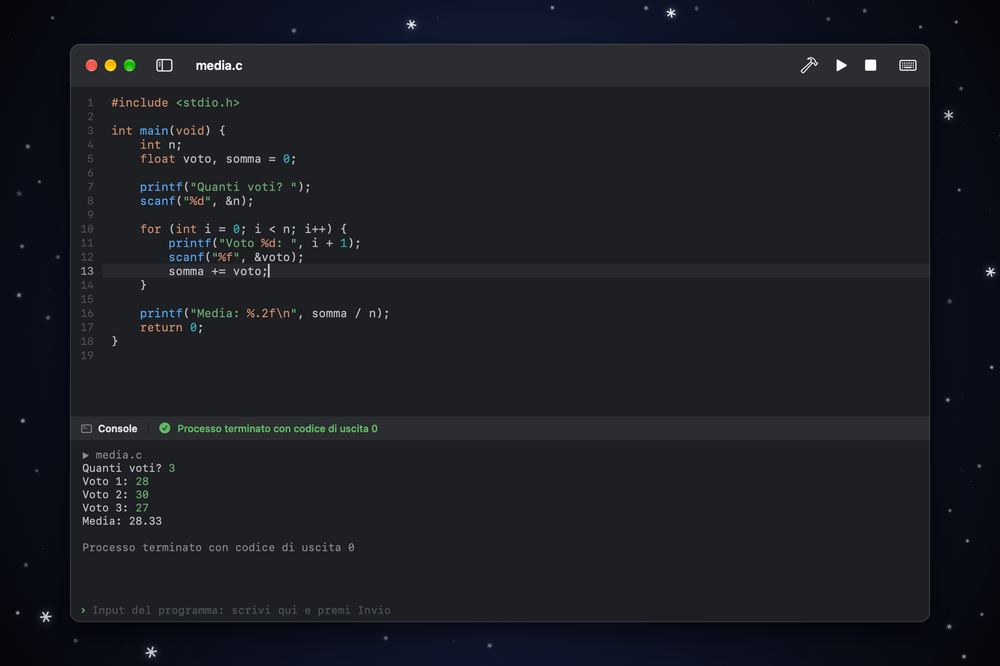
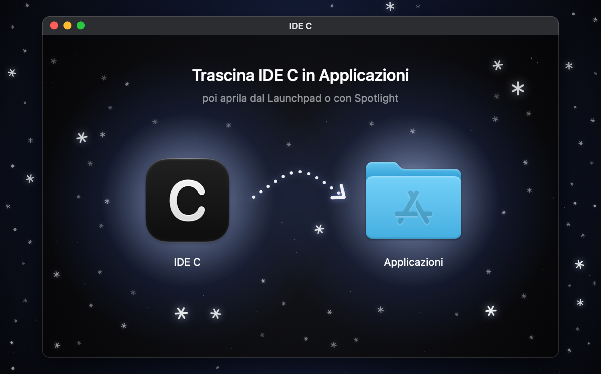

# IDE C

**Scrivi, compila ed esegui programmi in C sul Mac. Senza aiuti, solo scorciatoie.**

Scrivi `main`, premi <kbd>Tab</kbd> e il programma è già impostato. Premi <kbd>⌘</kbd><kbd>R</kbd> e gira.

[Tutte le versioni](https://github.com/Dariooone/ide-c/releases) · [Novità](CHANGELOG.md)

 

## Perché

Gli IDE completi suggeriscono, completano e correggono mentre scrivi: comodo, ma all'esame non ci sono.
IDE C non completa niente e non segnala errori mentre scrivi. Ti risparmia solo la parte noiosa:
`#include`, `int main`, `printf`, `scanf`, i `for`… li scrivi con una parola e <kbd>Tab</kbd>.

## Cosa fa

- **69 scorciatoie** in 8 gruppi: inizio del programma, `printf`, `scanf`, array, `if`/`for`/`while`, funzioni, `struct`, `malloc`, file.
  Dopo <kbd>Tab</kbd> il cursore salta da un punto da riempire al successivo.
- **Compila ed esegui** con un tasto. Il programma gira nella console in basso e puoi rispondere agli `scanf`;
  quello che scrivi compare in verde.
- **Errori cliccabili**: clic sull'errore e vai alla riga, segnata in rosso accanto al numero.
- **Messaggi in italiano** quando il programma si blocca, per esempio con un *segmentation fault*.
- **Albero dei file** a sinistra: cartelle, nuovo file, rinomina, sposta trascinando, Cestino.
- **Colori di CLion** (JetBrains): «Dark» col Mac scuro, «IntelliJ Light» col Mac chiaro.
- **Chiude da solo** parentesi, virgolette e `/* */`.
- **Standard del C a scelta**: C89/ANSI, C99, C11, C17, con `-Wall` e `-pedantic` attivabili.

## Installazione

1. [Scarica **IDE-C.dmg**](https://github.com/Dariooone/ide-c/releases/latest/download/IDE-C.dmg) e aprilo.
2. Trascina **IDE C** nella cartella **Applicazioni**.
3. Al primo avvio macOS la blocca perché non viene dall'App Store:
   apri **Impostazioni di Sistema → Privacy e sicurezza**, scorri in basso e premi **Apri comunque**. Serve una volta sola.

**Requisiti:** macOS 13 Ventura o successivo, Mac Apple Silicon o Intel.
Serve anche il compilatore di Apple (Command Line Tools): se manca, al primo «Compila» macOS propone di installarlo,
oppure lo installi da Terminale con `xcode-select --install`.

## Scorciatoie

Scrivi la parola e premi <kbd>Tab</kbd>. <kbd>⌘</kbd><kbd>K</kbd> apre la legenda con tutte le scorciatoie, la ricerca e l'anteprima del codice.

| Parola | Diventa | | Parola | Diventa |
|---|---|---|---|---|
| `main` | programma completo con `stdio` e `stdlib` | | `for` | `for (int i = 0; i < n; i++)` |
| `pf` | `printf("…\n");` | | `format` | doppio `for` per le matrici |
| `pfd` `pff` `pfs` | `printf` di un int, float, stringa | | `while` `do` | `while`, `do … while` |
| `pfa` `pfm` | stampa un array, una matrice | | `if` `ife` | `if`, `if … else` |
| `sf` `sfd` `sff` | `scanf` a scelta, int, float | | `sw` | `switch` con `case` e `default` |
| `sfl` | legge una riga intera con gli spazi | | `fn` `proto` | funzione, prototipo |
| `sfeof` | legge numeri finché finisce l'input | | `ts` | `typedef struct` |
| `ask` | chiede un numero e lo legge | | `mal` | `malloc` con controllo |
| `askv` | chiede finché il valore va bene | | `fopen` | apre un file con controllo |

### Tasti

| Tasti | Cosa fa | | Tasti | Cosa fa |
|---|---|---|---|---|
| <kbd>⌘</kbd><kbd>B</kbd> | compila e mostra gli errori | | <kbd>⌘</kbd><kbd>N</kbd> | nuovo file nella cartella scelta |
| <kbd>⌘</kbd><kbd>R</kbd> | compila ed esegui | | <kbd>⇧</kbd><kbd>⌘</kbd><kbd>S</kbd> | mostra o nasconde i file |
| <kbd>⌘</kbd><kbd>.</kbd> | ferma il programma | | <kbd>⇧</kbd><kbd>⌘</kbd><kbd>O</kbd> | sceglie la cartella del progetto |
| <kbd>⌘</kbd><kbd>D</kbd> | fine input (EOF) | | <kbd>⌘</kbd><kbd>/</kbd> | commenta le righe |
| <kbd>⌘</kbd><kbd>K</kbd> | legenda delle scorciatoie | | <kbd>⌘</kbd><kbd>,</kbd> | impostazioni |

## Per chi vuole modificarla

IDE C è scritta in Swift con AppKit, senza dipendenze e senza Xcode.
Come si costruisce, come è organizzato il codice e come si pubblica una versione: [docs/SVILUPPO.md](docs/SVILUPPO.md).
